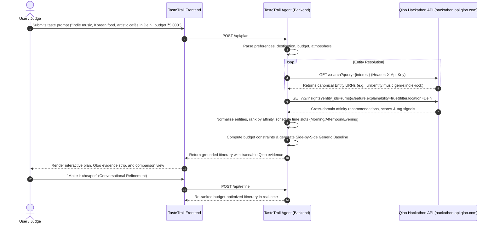

# ✦ TasteTrail AI — Discover What You'll Actually Love

> **Agentic Cultural Discovery Platform Powered by Qloo's Cultural Taste Intelligence**  
> Developed for the **Qloo Agentic Hackathon** by student developer **Ankit Kumar**.

[]()
[]()
[]()
[](LICENSE)

---

## 🌟 Executive Summary
Generic AI systems generate plausible-sounding travel lists, but they default to superficial popularity metrics and tourist cliches. If you love indie music, Korean street cuisine, and brutalist architecture, generic engines will still suggest mainstream landmarks.

**TasteTrail AI** solves this by anchoring its agentic planning in **Qloo’s cultural intelligence graph**. It resolves your exact artistic and culinary tastes through Qloo's Search API, extracts cross-domain affinity correlations via Qloo's `/v2/insights` endpoint, and compiles personalized, budget-conscious itineraries where **every single recommendation is traceable to empirical cultural taste signals**.

---

## 💡 How Qloo Materially Powers TasteTrail AI

Unlike applications that merely attach a sponsor badge, Qloo is the core reasoning backbone of TasteTrail AI:



### 1. Entity Resolution (`GET /search`)
User preferences (such as `"indie music"`, `"korean food"`, `"contemporary art"`) are resolved into valid canonical Qloo URNs (e.g. `urn:entity:music:genre:indie-rock`, `urn:entity:cuisine:korean`).

### 2. Cross-Domain Cultural Affinities (`GET /v2/insights`)
TasteTrail AI queries `/v2/insights` with the resolved entity seeds and destination filters, retrieving non-obvious cultural places that exhibit high affinity with the user's combined tastes.

### 3. Traceable Personalization Evidence
Every card in TasteTrail AI displays an **Evidence Signal** tag:
> *Correlated via: `urn:entity:music:genre:indie-rock` (94% Affinity Score)*

### 4. Transparent Baseline Comparison
TasteTrail AI includes a 1-click **"Compare Baseline"** engine demonstrating the difference between:
- **Standard Popularity Baseline**: Ranks places strictly by mass search volume (e.g. generic tourist malls and monuments).
- **Qloo-Grounded Plan**: Discovers artisan enclaves, authentic indie jazz venues, and contemporary galleries matching specific taste affinities.

---

## 🚀 Key Features

| Feature | Description |
| :--- | :--- |
| **✨ 1-Click Judge Demos** | Instant preset prompts for Delhi (Indie & Korean), Tokyo (Jazz & Architecture), and London (Vinyl & Historic Pubs). |
| **⚡ Conversational Refinement** | Live agentic adjustments (*"Make it cheaper"*, *"More art & galleries"*, *"Skip restaurant stops"*, *"Make it more relaxed"*). |
| **💰 Honest Budget Tracking** | Calculates estimated spend against target budget constraints with clear disclosure of estimates. |
| **🔍 Qloo Transparency Inspector** | Real-time panel showing API latency, entity resolution trace, and active connection mode without leaking keys. |
| **⚖️ Side-by-Side Comparison** | Direct visual comparison showing why Qloo cultural grounding outperforms generic popularity engines. |
| **🔖 Saved Discoveries** | LocalStorage persistence with 1-click JSON export for trip planning. |
| **🛡️ Zero-Leak Security** | Qloo API credentials reside strictly server-side with `X-Api-Key` headers; client requests are proxied securely. |

---

## 🛠️ Tech Stack & Architecture

- **Backend Runtime**: Node.js v24 (Native ES Modules, Express 4.21 with zero-leak credential proxying).
- **Frontend Architecture**: React 18 + Vite SPA, React Router 6, custom editorial dark design system with glassmorphic cards and Google Fonts (Outfit & Inter).
- **Sponsor Tech**: Qloo Hackathon API (`hackathon.api.qloo.com`) via `GET /search` and `GET /v2/insights` with `X-Api-Key` headers, type validation, and rate limit backoff.
- **Testing**: Node's native test runner (`node --test`) with 28 automated tests covering client headers, upstream mock responses, error sanitization, timeout handling, backoff retries, and API routes.
- **Resilience**: Authentic Qloo-schema demo fixtures when API keys are unconfigured, ensuring 100% demo reliability.

---

## 📦 Quickstart & Running Locally

### 1. Clone & Navigate
```bash
git clone <repo-url>
cd hackathons/tastetrail-ai
```

### 2. Install Dependencies & Build Frontend
```bash
npm install
npm run build
```

### 3. Environment Configuration
Copy `.env.example` to `.env`:
```bash
cp .env.example .env
```
Edit `.env` to configure your credentials:
```env
PORT=3000
QLOO_BASE_URL=https://hackathon.api.qloo.com
QLOO_API_KEY=your_actual_hackathon_api_key_here
```
*(If `QLOO_API_KEY` is not provided, TasteTrail AI runs seamlessly in **Demo Mode** using authentic Qloo-schema fixtures without failing).*

### 4. Start the Application
```bash
npm start
# Server will start on http://localhost:3000 serving the React SPA and API
```
Open your browser and navigate to `http://localhost:3000`.

### 5. Run Automated Tests
```bash
npm test
```
*Executes all 28 unit, route, and mock-backed provider tests with zero errors.*

---

## 🌐 External Deployment Instructions

TasteTrail AI is engineered to be deployed in minutes to any hosting provider.

### Option A: Render (Recommended for Full-Stack Node)
1. Fork or push this repository to GitHub.
2. In [Render Dashboard](https://dashboard.render.com), click **New → Web Service**.
3. Select your repository and configure:
   - **Environment**: Node
   - **Root Directory**: `hackathons/tastetrail-ai`
   - **Build Command**: `npm run build`
   - **Start Command**: `npm start`
4. In **Environment Variables**, add:
   - `QLOO_API_KEY`: `<your-qloo-api-key>`
   - `QLOO_BASE_URL`: `https://hackathon.api.qloo.com`
   - `NODE_ENV`: `production`
5. Click **Deploy**. Render will provide a live HTTPS URL.

### Option B: Railway
1. In [Railway](https://railway.app), create a new project from your GitHub repo.
2. Set Root Directory to `hackathons/tastetrail-ai`.
3. Set environment variable `QLOO_API_KEY`.
4. Railway automatically detects `npm start` and deploys to a public URL.

### Option C: Vercel (Using `vercel.json`)
A pre-configured `vercel.json` is included in the project directory for serverless node execution.

---

## 📄 License
This project is open-source and licensed under the **[MIT License](LICENSE)**.
